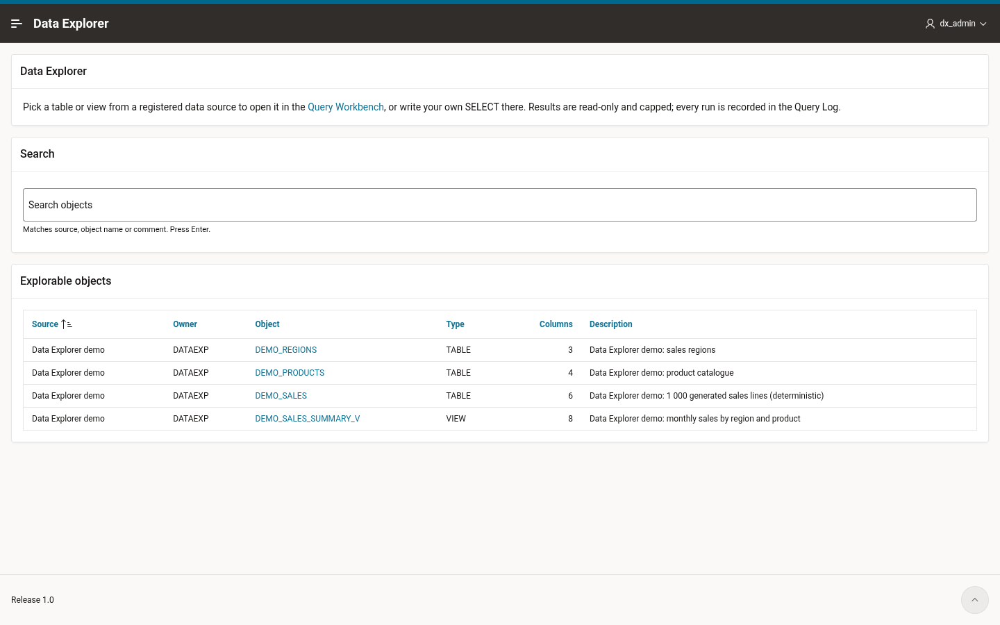
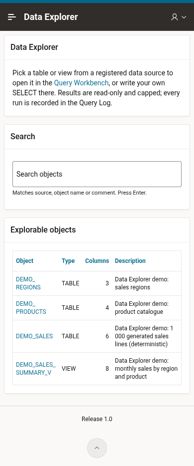
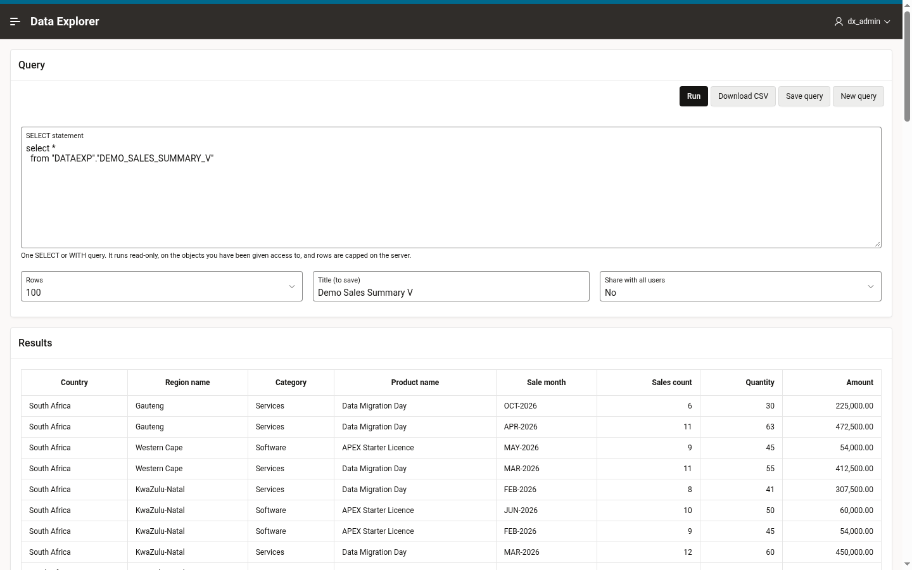
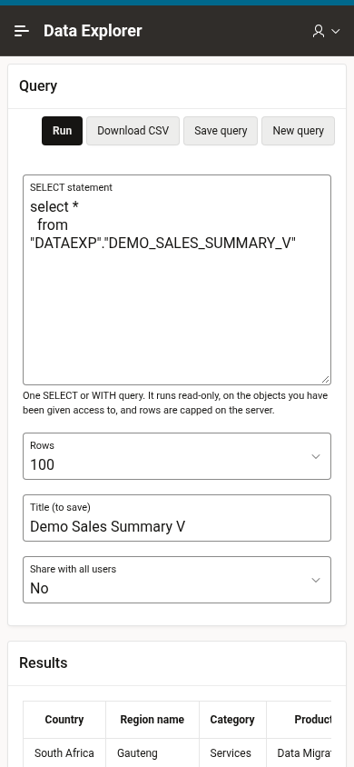

# Data Explorer

## About
Data Explorer as an ad-hoc query and analysis reporting tool designed for developer and End-Users for an easy access point to their relational database and External Data Sources. Data Explorer enables users at all levels to make faster and more informed decisions by focusing on a single view of data while hiding the complexity of the underlying data structures and enabling the delivery of analytical content via Mobile and Web Browsers as a report

## What is in this folder

| Path | What it is |
| --- | --- |
| `database/00_admin_create_schema.sql` | Creates (or resets) the `DATAEXP` parsing schema and the read-only `DATAEXP_RO` query schema, grants, workspace mapping. Run as ADMIN. |
| `database/install_db.sql` | Ordered, idempotent install of everything in `DATAEXP` (calls 01-06). |
| `database/01_tables.sql` | Settings, data sources, REST cache, saved queries, query log. |
| `database/02_dx_api.pks`, `04_dx_api.pkb` | `DX_API` package: SQL validation, execution, HTML/CSV output, saved queries, data sources. |
| `database/03_views.sql` | `DX_CATALOG_V` / `DX_COLUMNS_V` - what users can explore. |
| `database/05_app_views.sql` | Row-filtered views for the APEX pages. |
| `database/06_seed.sql` | Settings, demo sales data set, default data source, two shared sample queries; `SELECT` grants on the demo objects to `DATAEXP_RO`. |
| `database/07_admin_readonly.sql` | Creates the query runner `DATAEXP_RO.DX_EXEC` and private synonyms. Run as ADMIN after `install_db.sql`. |
| `database/uninstall.sql` | Removes the app, the workspace mappings and both schemas. |
| `apex/f220.sql` | APEX 26.1 application export (Universal Theme, Oracle APEX Accounts). |
| `apex/install_app.sql` | Imports `f220.sql` into a workspace with a chosen app id. |
| `tests/smoke_test.sql` | 49 PASS/FAIL checks; exits non-zero on any failure. |
| `scripts/install.sh` / `uninstall.sh` | One-shot install/uninstall + smoke test with SQLcl. |
| `apex/create_app_user.sql` | Optional: creates an APEX account in the workspace and adds it to `ADMIN_USERS`. |

## How it works

* **Data sources** are registered in `DX_DATA_SOURCES`:
  * `SCHEMA` - every table/view of an owner that `DATAEXP` can `SELECT`. `ALL_OBJECTS` drives the
    catalog, so users only ever see what has been granted to `DATAEXP`.
  * `REST` (external data) - a JSON endpoint is fetched with `APEX_WEB_SERVICE`, cached in
    `DX_REST_CACHE`, and exposed as a relational view `DX_REST_<id>` through `JSON_TABLE`
    (you supply the column list, e.g. `id number path '$.id', name varchar2(200) path '$.name'`).
* **Queries run read-only, in their own schema.** Free-text SQL from the Workbench never runs as
  `DATAEXP`. It runs on page 6, whose parsing schema the application's Initialization PL/SQL Code
  switches to `DATAEXP_RO` (`apex_util.set_parsing_schema_for_request`). `DATAEXP_RO` has no
  system privileges at all, not even `CREATE SESSION`; it holds only `SELECT` grants on the
  objects users may query (the demo objects, REST views, and whatever you grant it).
  * **Validation is done by the parser, not by string matching.** `DATAEXP_RO.DX_EXEC.CHECK_SQL`
    parses the text with `DBMS_SQL.PARSE`, as `DATAEXP_RO`, wrapped as an inline view
    (`select * from ( <your query> )`). Only one `SELECT`/`WITH` query can parse there, so DML,
    DDL, PL/SQL, `WITH FUNCTION`, `FOR UPDATE` and multiple statements are rejected, along with any
    table the schema has no grant on (Data Explorer's own tables included). The statement is
    parsed but never executed.
  * **Execution goes through `APEX_EXEC`** with `p_max_rows` set on the server. The cap is the
    smaller of the Rows choice, the `MAX_ROWS` setting (held in a restricted application item)
    and a hard limit of 10,000. `DX_EXEC` refuses to run unless `APEX_EXEC` is really parsing as
    `DATAEXP_RO`.
  * **Results grid:** headings are readable (`SALE_MONTH` becomes *Sale month*). Numbers are
    right-aligned with thousands separators; amount, price and cost columns get 2 decimals
    (`999G999G990D00`), and id columns get no separators. Month values (first-of-month dates in a
    `*MONTH*` column) show as `MON-YYYY`, other dates as `DD-MON-YYYY`. CSV keeps the raw values.
    On small screens the grid scrolls sideways inside its region.
  * The result and a log entry are handed back to `DATAEXP` in APEX collections. `DATAEXP` writes
    the entry to `DX_QUERY_LOG` on the next page view.
* **Saved queries** are private or shared; run counts are tracked.

## The APEX app (mini app, 5 pages + run page)

| Page | Purpose |
| --- | --- |
| 1 Explore | Search the catalog; click an object to open it in the workbench. |
| 2 Query Workbench | Write/run a SELECT, pick a row limit, download CSV, save/share the query; shows the object's columns. |
| 3 Saved Queries | Own and shared queries; click to open. |
| 4 Query Log | Your runs (admins see everyone's), status, rows, elapsed ms, errors. |
| 5 Data Sources | Admins only (`ADMIN_USERS` setting): add schema/REST sources, refresh REST data, enable/disable. |
| 6 Run Query | No UI. Runs the Workbench query as `DATAEXP_RO` and returns to page 2 (or streams the CSV). |
| 9999 Login | Oracle APEX Accounts. |

## Requirements

* Oracle Database 19c+ (developed for Autonomous Database 26ai) with APEX 26.1 (export version `2026.03.30`).
* SQLcl (or SQL*Plus) on the host that runs the install.
* ADMIN (or a DBA) once, to create `DATAEXP` and `DATAEXP_RO` and the objects inside `DATAEXP_RO`. Privileges used are all available to ADB `ADMIN`:
  `CREATE USER`, `GRANT CREATE SESSION/TABLE/VIEW/PROCEDURE/SEQUENCE/TYPE`, quota on `DATA`,
  `APEX_INSTANCE_ADMIN.ADD_SCHEMA`, `CREATE ANY PROCEDURE/SYNONYM` (for `DATAEXP_RO`). `DATAEXP` itself needs no system or `DBA_*` access.
* REST sources call out through `APEX_WEB_SERVICE`; the target host must be allowed by the instance's
  network ACL (public HTTPS hosts are allowed for APEX on ADB).

## Install

```bash
export DX_CONNECT='<TLS connect descriptor or tns alias>'   # or a tnsnames alias with TNS_ADMIN set
export DX_ADMIN_PASSWORD=...        # read from your secret store, do not type into history
export DX_SCHEMA_PASSWORD=...       # new strong password for DATAEXP (no quotes, @ or /)
export DX_RO_PASSWORD=...           # new strong password for DATAEXP_RO (keep it in your secret store)
export DX_WORKSPACE=DATA_EXPLORER DX_APP_ID=220 DX_ADMIN_USERS=ADMIN   # pick a free app id
scripts/install.sh
```

or step by step from SQLcl:

```sql
-- as ADMIN, in database/
@00_admin_create_schema.sql "<dataexp password>" DATA_EXPLORER "<dataexp_ro password>"
-- as DATAEXP, in database/
@install_db.sql "ADMIN,OTHER_ADMIN"
-- as ADMIN, in database/
@07_admin_readonly.sql
-- as ADMIN, in apex/
@install_app.sql DATA_EXPLORER 220
-- optional, as ADMIN, in apex/: an APEX account to sign in with
@create_app_user.sql DATA_EXPLORER <USERNAME> "<password>"
-- as DATAEXP, from the project folder
@tests/smoke_test.sql 220
```

No SQLcl on the host? The scripts also run through ORDS REST-enabled SQL once `@@` includes are
inlined and `whenever sqlerror` lines are removed (that endpoint rejects them); keep `set define off`
around 01-05 as `install_db.sql` does (and in `07_admin_readonly.sql`).

Keep passwords in a secret store and pass them via environment or stdin, never on the command line.

Every step is idempotent: re-running upgrades in place, keeps saved queries/logs and only loads demo
rows into empty tables. Then open `.../ords/r/<workspace>/data-explorer/home` and sign in with an
APEX account of that workspace.

To expose more data: `grant select on HR.EMPLOYEES to DATAEXP;` (catalog) and
`grant select on HR.EMPLOYEES to DATAEXP_RO;` (queries), then add the `HR` schema on page 5.

## Test

`tests/smoke_test.sql <APP_ID>` (run as `DATAEXP`) checks:
* objects are valid, the demo data and catalog filtering
* `DATAEXP_RO` holds nothing but `SELECT` grants and none on Data Explorer's tables
* inside an APEX session on the run page:
  * DML (`DELETE`, `UPDATE`), DDL (`DROP`, `CREATE`), multi-statement input, PL/SQL blocks,
    `WITH FUNCTION`, `FOR UPDATE`, unparseable SQL, and `SELECT` on non-granted tables or
    dictionary views are all rejected, and none of them change data
  * queries really execute as `DATAEXP_RO`
  * the row cap is enforced on the server (10 rows, and the 10,000 hard cap when 999,999 are asked for), for CSV too
  * number, month and heading formatting, HTML escaping, and CLOB/TIMESTAMP rendering
* the runner refuses to execute outside the run page
* the saved-query round trip, run counts and the run log
* the REST-to-view pipeline (offline payload, no network)
* app pages 1-6 and 9999 exist

It prints `RESULT: n passed, m failed` and exits non-zero on failure. Test rows are cleaned up.

## Uninstall

```bash
DX_CONNECT=... DX_ADMIN_PASSWORD=... DX_WORKSPACE=DATA_EXPLORER DX_APP_ID=220 scripts/uninstall.sh
```

This drops `DATAEXP` (with its saved queries and log) and `DATAEXP_RO`.

## Settings (`DX_SETTINGS`)

| Key | Default | Meaning |
| --- | --- | --- |
| `MAX_ROWS` | 500 | Row cap for screen and CSV, enforced on the server (never above 10000). |
| `ADMIN_USERS` | install arg | Comma-separated APEX users who manage data sources and see all logs. |

Change with `exec dx_api.set_setting('MAX_ROWS','1000'); commit;` as `DATAEXP`.

## Security notes

* Free-text queries run as `DATAEXP_RO`, which has no system privileges and only `SELECT` grants.
  Grant it exactly what users may read. It cannot write anything and cannot see Data Explorer's
  own tables.
* Validation is done by the parser (as `DATAEXP_RO`), and the validated text is exactly what
  `APEX_EXEC` executes. Users can still call functions in `SELECT` that `DATAEXP_RO` can execute,
  so do not grant it execute on anything with side effects. Public database links in the database
  would also be visible to it.
* Output is HTML-escaped; CSV values are quoted per RFC 4180.

## Screenshots

| Desktop | Phone (390 px) |
| --- | --- |
|  |  |
|  |  |

On narrow screens the Explore catalog hides the Owner and Source columns, long object names wrap only after an underscore (the name is escaped first, then a `<wbr>` is added after each underscore, so links and copy-paste still use the plain name), and wide result grids scroll horizontally inside their own region instead of widening the page.
