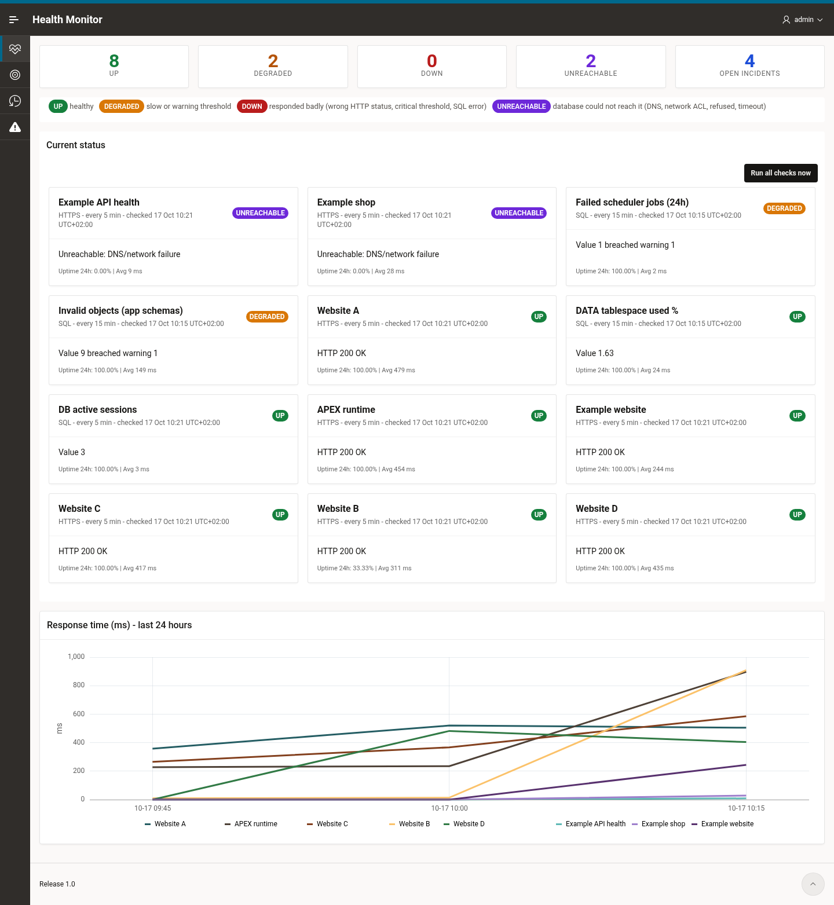

# apex-health-monitor

A lightweight Oracle APEX app that watches websites and database health checks,
records every result and opens and closes incidents on its own.

* **HTTPS endpoints**: the database sends a GET request. The result is **UP** when the expected HTTP status
  comes back within the thresholds, **DEGRADED** when the response is slow, and **DOWN** when the site
  responds badly (wrong status or critical response time).
* **UNREACHABLE**: the database could not reach the target at all (DNS/network failure: name lookup failed,
  network ACL, connection refused, connect or transfer timeout). It is kept separate from DOWN so a network
  problem doesn't read as a broken site.
* **SQL checks**: a single `SELECT` that returns one number, compared with the warning and critical
  thresholds (for example active sessions, tablespace usage, failed scheduler jobs, invalid objects).
  A SQL error counts as DOWN.
* **Incidents**: opened when a target leaves UP, escalated if it gets worse
  (DEGRADED → UNREACHABLE → DOWN), and closed automatically when the target recovers. Each incident records
  its duration, how many checks failed, and the error text, with every error code shown once.
* **Scheduler**: `HM_RUN_CHECKS` runs every minute and checks only the targets whose own interval is due.
  `HM_PURGE_HISTORY` deletes check history older than 30 days.

One schema, three tables, one package, two views, two jobs and a 7-page app with no plug-ins or custom
JavaScript. It works on desktop and phone.

## Pages

| Page | What it shows |
|------|---------------|
| 1 Dashboard | Up / Degraded / Down / Unreachable / open-incident totals, a status legend, a status card per target with 24h uptime and average response time, a 24-hour response-time chart, and **Run all checks now** |
| 2 Targets | Interactive report of all targets with status, uptime (24h / 7d), average response time and last result |
| 3 Target | Form to add or edit a target (validated), with **Save**, **Save and check now** and **Delete** |
| 4 Check History | Every check in the last 7 days, with a filter by target |
| 5 Incidents | Open and resolved incidents with severity and duration |
| 9999 Login | APEX accounts sign-in |

## Layout

```
apex-health-monitor/
  apex/f2600.sql                    APEX 26.1 application export (app 2600, alias HEALTH-MONITOR)
  install/00_admin_setup.sql        DBA: HEALTH_MON schema, grants, HTTPS ACE, workspace + admin user
  install/01_tables.sql             HM_TARGETS, HM_CHECKS, HM_INCIDENTS
  install/02_hm_pkg.pks/.pkb        Check engine (HTTP + SQL), incidents, uptime, purge
  install/03_views.sql              HM_TARGET_STATUS_V, HM_INCIDENTS_V
  install/04_jobs.sql               HM_RUN_CHECKS (every minute), HM_PURGE_HISTORY (daily)
  install/05_seed.sql               Example targets (example.com) + database checks
  install/targets.local.sql.example Template for your real targets (copy to targets.local.sql, git-ignored)
  install/install_schema.sql        Fresh install of 01-05 as HEALTH_MON
  install/upgrade_1_1.sql           Upgrade a 1.0 install (UNREACHABLE status, message clean-up)
  install/upgrade_1_2.sql           Upgrade a 1.1 install (display time zone setting)
  install/hm_settings.sql           Settings table (HM_SETTINGS), re-runnable
  install/install_app.sql           Imports apex/f2600.sql into workspace HEALTH_MON
  install/deploy.sh                 Deploy + test, configured only through environment variables
  install/uninstall.sql             Drops the schema objects
  tests/test_hm_pkg.sql             Self-cleaning PL/SQL tests
  tools/gen_app.py                  Generator for apex/f2600.sql
```

## Install

Needs Oracle Database with APEX 26.1 (built and tested on Autonomous Database) and SQLcl.

```bash
export ADB_HOST=<listener host> ADB_SERVICE=<service name>
export DBA_USER=<dba user> DBA_PASSWORD=<from your secret store>
export SCHEMA_PASSWORD=<from your secret store>
export APP_ADMIN_USER=<workspace admin name> APP_ADMIN_PASSWORD=<from your secret store>
# optional: tunnel through a jump host, e.g. JUMP_HOST=opc@203.0.113.10 JUMP_KEY=~/.ssh/<key>
FRESH=Y ./install/deploy.sh      # first install; later runs (without FRESH) upgrade in place
```

To run the steps by hand (each script can be run again safely):

1. As a DBA: `@install/00_admin_setup.sql "<SCHEMA_PASSWORD>" "<APP_ADMIN_PASSWORD>" "<APP_ADMIN_USER>"`
2. As HEALTH_MON: `@install/install_schema.sql` (or `@install/upgrade_1_1.sql` then `@install/upgrade_1_2.sql` on an older install; both are re-runnable), then
   optionally `@install/targets.local.sql`
3. As a DBA: `@install/install_app.sql`
4. As HEALTH_MON: `@tests/test_hm_pkg.sql`, which should end with `ALL TESTS PASSED`

The app is at `https://<your-apex-host>/ords/r/health_mon/health-monitor/`. Sign in with the workspace admin user.

No passwords or connection details are kept in this repo. Keep them in your secret store and pass them in
through the environment.

## Display time zone

Dates in the app are shown in the time zone from the `display_timezone` setting,
and column headings show its UTC offset (for example "Started (UTC+00:00)").
When the setting is empty the database session time zone is used. Set it with:

```sql
update hm_settings set value = '<time zone region or offset>' where name = 'display_timezone';
commit;
```

Keep an environment's value in a git-ignored `install/*.local.sql` script;
`deploy.sh` runs `install/settings.local.sql` if it exists.

## Adding checks

Add checks in **Targets → Add target**, or in `install/targets.local.sql`.

* HTTP: an `https://` URL. Autonomous Database only allows outbound HTTPS, and the ACE is limited to port 443.
  Thresholds are in milliseconds.
* SQL: `select <number> from ...` with no trailing semicolon. It runs as `HEALTH_MON`, so that schema needs
  read access to whatever the query uses.

## Uninstall

As HEALTH_MON run `@install/uninstall.sql`. Then, as a DBA, run
`apex_instance_admin.remove_workspace('HEALTH_MON')` and `drop user health_mon cascade`.

## Screenshots

Screenshots are in [`docs/screenshots`](docs/screenshots). Target names, URLs, host names, user names
and error details are redacted.


