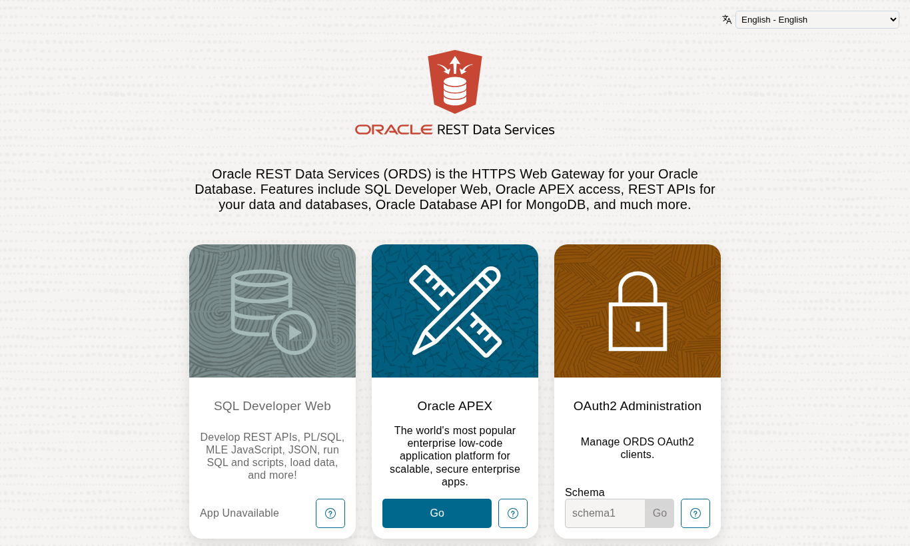
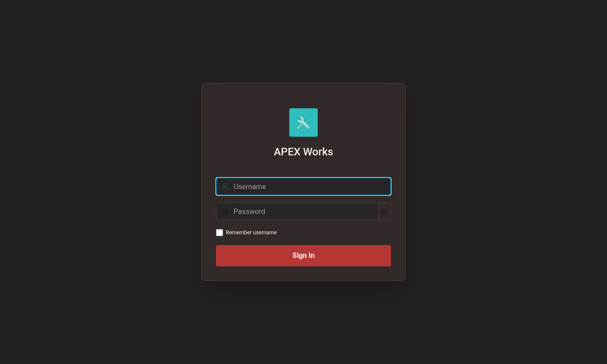

# apex-infrastructure-centos

Run **Oracle APEX on your own CentOS / Oracle Linux host**: ORDS (standalone) behind nginx, talking to
an **Autonomous Database** or a local **Oracle Database 23ai Free**. Started in 2018 as a CentOS 7 +
18c XE + Tomcat + httpd guide; brought up to date for 2026 with scripts you can actually run.

| File | Purpose |
|---|---|
| [install-guide.md](install-guide.md) | current step-by-step guide (architecture, ADB or 23ai Free, ORDS, nginx, verification, operations) |
| [scripts/](scripts) | `install-all.sh` + numbered steps `01`..`06`, `uninstall.sh`, `apex-ords.env.example` (no secrets) |
| [sql/](sql) | ADB customer-managed ORDS users: create (idempotent), verify, remove |
| [templates/](templates) | `ords.service` (systemd) and `nginx-apex.conf.template` |
| [cloud-init/](cloud-init) | unattended install on a new cloud VM |
| [additional-applications.md](additional-applications.md) | Glances + InfluxDB + Grafana host monitoring (with 2026 notes) |
| [legacy-centos7-install-guide.md](legacy-centos7-install-guide.md) | the original 2018 guide, kept for reference |

## Quick start

```bash
sudo cp scripts/apex-ords.env.example /etc/apex-ords/apex-ords.env && sudo vi /etc/apex-ords/apex-ords.env
sql admin@mydb_low @sql/adb-customer-managed-ords.sql ORDS_PUBLIC_USER2 ORDS_PLSQL_GATEWAY2   # ADB only
sudo ./scripts/install-all.sh
```

## Design choices

* **Lightweight**: no Tomcat, no AJP, no 400 MB images copy (APEX CDN through nginx), ORDS heap 320 MB, so it fits a 1 GB Always Free VM.
* **Safe on a shared web server**: ORDS binds to `127.0.0.1`; nginx gets one extra `server_name`; every changed file is backed up and `nginx -t` gates the reload.
* **No secrets in config or git**: the ORDS runtime password comes from a root-only file, OCI Vault, or a hidden prompt and is stored only in the ORDS wallet.
* **Doesn't touch ADB settings** shared with the built-in ORDS (`IMAGE_PREFIX` stays as it is).

## Validation

Tested end to end on 2026-10-17: Oracle Linux 7.9 on a 1 GB Always Free VM (2 vCPU, ~670 MB usable RAM,
swap on), customer-managed ORDS 26.3 + nginx 1.20, talking to an Autonomous Database 26ai with APEX 26.1.5.
The VM already served other sites through nginx; they kept answering throughout.

* `shellcheck -S warning` clean on all scripts; cloud-init YAML parses.
* `sql/adb-verify.sql`: runtime user OPEN, gateway user `NONE` auth, proxy grant YES, `ORDS_RUNTIME_ROLE` YES.
* `scripts/06-smoke-test.sh` on the host: **16 passed, 0 failed**

```
== host checks
  PASS java >= 17                          java version "21.0.12.1" LTS
  PASS ords binary                         Services 26.3.0.r2721811
  PASS ords.service active                 active
  PASS ords bound to loopback only         127.0.0.1:8080
  PASS ORDS direct 127.0.0.1:8080          HTTP 302
  PASS nginx config valid                  valid
  PASS ords.log has no pool errors
== web checks (https://apex.example.com)
  PASS nginx /health                       HTTP 200
  PASS http -> https redirect              HTTP 301
  PASS TLS handshake (1.2+)                ok
  PASS ORDS landing /ords/                 HTTP 302
  PASS APEX page renders (/ords/f?p=<app>:9999)   /i/26.1.5/ Sign In
  PASS APEX f?p=4550 (App Builder login)   HTTP 302
  PASS static /i/26.1.5/ Core CSS          HTTP 200
  PASS static /i/26.1.5/ desktop JS        HTTP 200
  PASS no server version leak
== result: 16 passed, 0 failed
```

* Memory: ORDS RSS ~350 MB while starting, ~120 MB resident when idle (rest in swap); start-up ~60 s
  with a short swap burst, then no swap-out at idle. See install-guide 3.7 for the caveats found
  (CLI heap, App Builder sign-in on ADB).
* An *Oracle APEX Accounts* application signed in successfully through nginx → ORDS → ADB.

| ORDS landing page through nginx | APEX application login through nginx |
|---|---|
|  |  |
