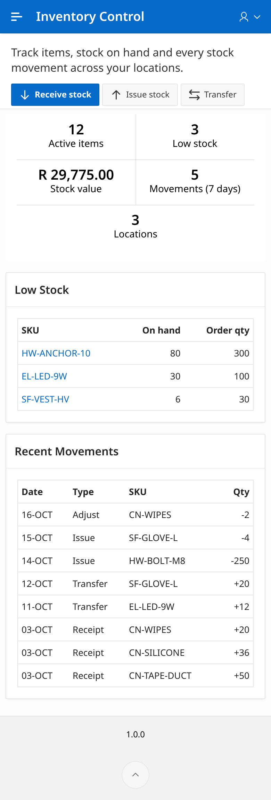
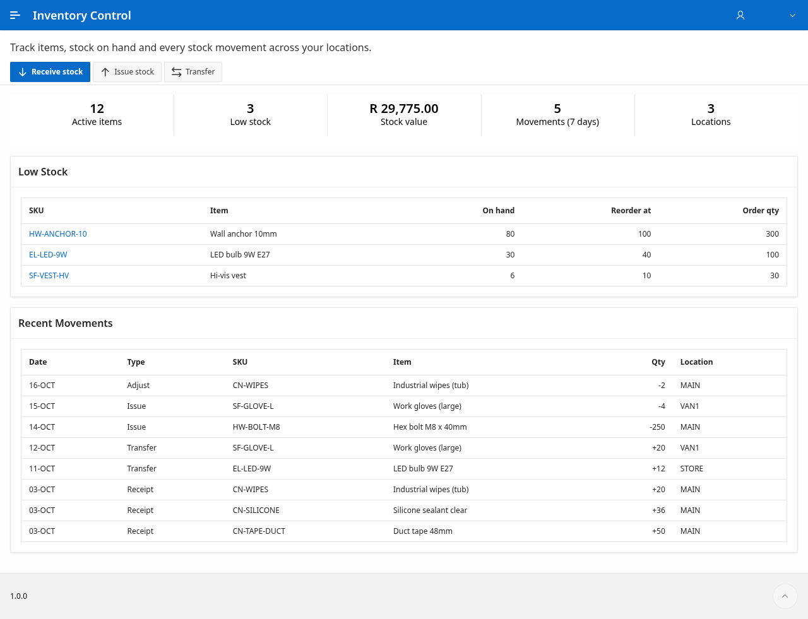
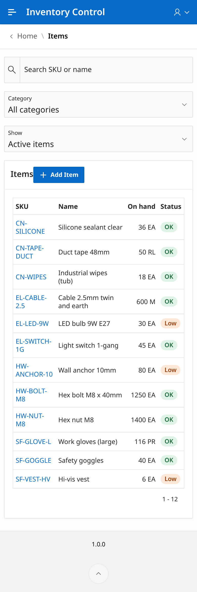
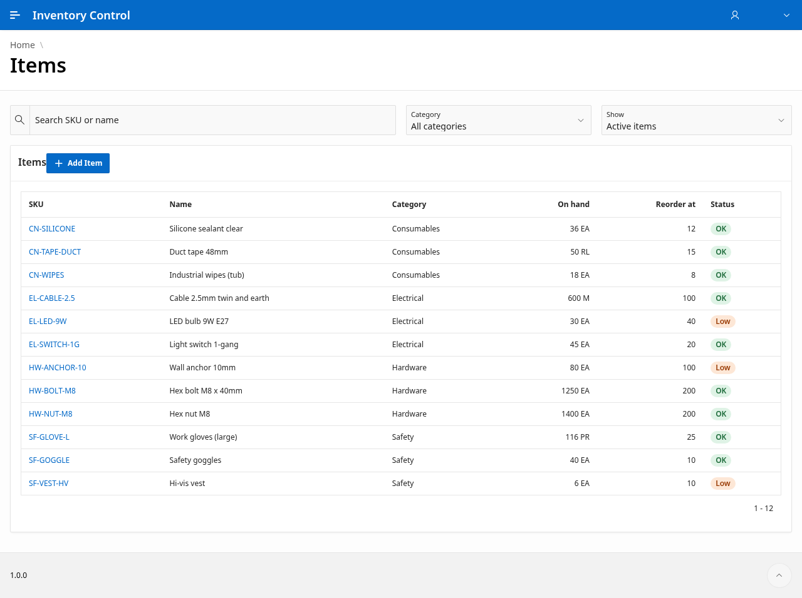
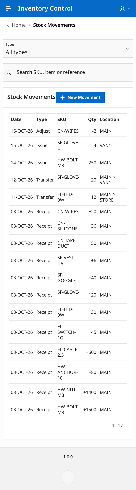
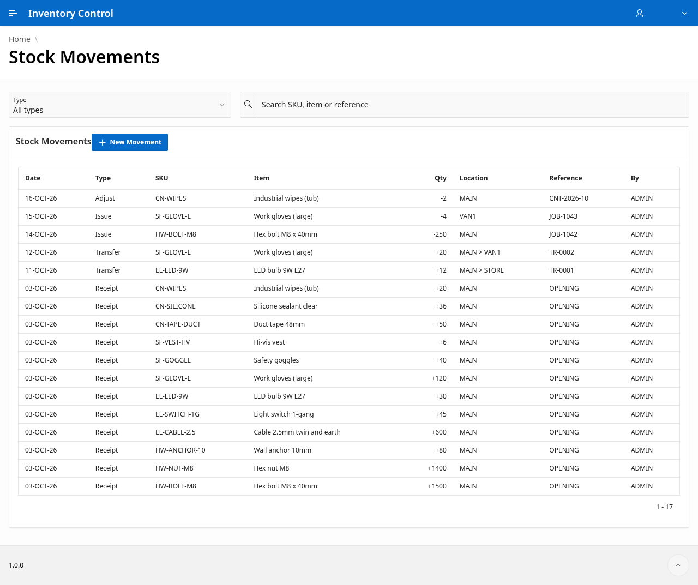
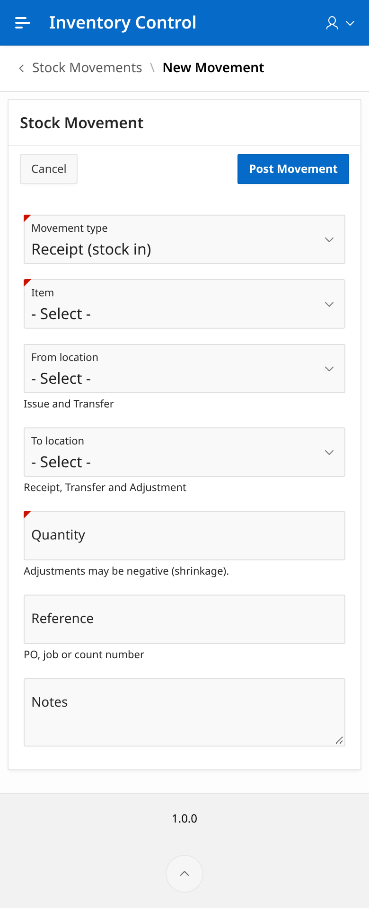
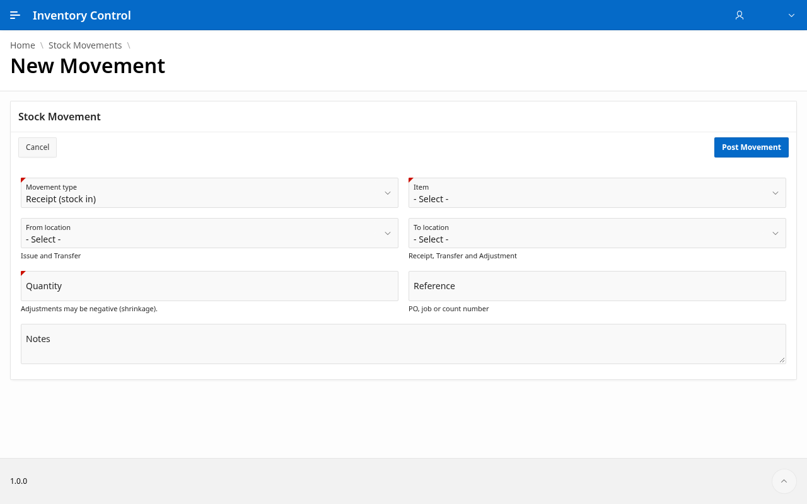

# APEX Inventory Control

A lightweight Oracle APEX 26.1 mini app for stock control: items, locations, suppliers and
categories, stock on hand per location, and an immutable ledger of stock movements
(receipts, issues, transfers and count adjustments) with reorder-level alerts.

| | |
|---|---|
| APEX | 26.1 (Universal Theme 42 / 26.1, Vita style, compatibility mode 26.1) |
| Application | 1301, alias `INVENTORY-CONTROL` |
| Workspace / schema | `INVENTORY_CONTROL` / `INVENTORY_CONTROL` |
| Authentication | Oracle APEX Accounts |

## Design

* **Schema (`INV_*`)**: `inv_categories`, `inv_locations`, `inv_suppliers`, `inv_items`,
  `inv_stock` (on hand per item and location, never negative) and `inv_transactions`
  (the movement ledger). Identity keys, check constraints, FK indexes and audit columns.
* **Views**: `inv_items_v` (on hand, stock value, low-stock flag and suggested order quantity), `inv_stock_v`,
  `inv_transactions_v`, `inv_dashboard_v`.
* **PL/SQL API `inv_api`**: every write goes through it (`save_*`, `delete_*`,
  `post_transaction`). It validates input, locks stock rows (`select ... for update`, fixed
  lock order for transfers), refuses to take stock below zero, and raises readable
  `ORA-20001..20099` messages. Page processes contain only a single API call.
* **Reorder rule**: an item's reorder quantity must be greater than 0 (API, table check and form
  validation). If it's left empty, it defaults to the reorder level, with a minimum of 1. For a
  low-stock item the suggested order is the reorder quantity when it is positive; otherwise it
  is `greatest(reorder_level - on_hand, 1)`, so it is never 0.
* **`inv_ui_error`**: the app's error handling function. It shows API messages without the
  ORA prefix and hides internal error detail.
* **UI**: 13 pages (Home dashboard, Items + form, Stock on Hand, Stock Movements + new
  movement, Locations / Categories / Suppliers + forms, Sign In). Floating labels and
  stretched inputs on a 12-column grid. Secondary report columns hide below 640px, so
  every page fits a 390px phone without horizontal scrolling.

## Layout

```
apex-inventory-control/
  database/
    admin/00_create_schema_and_workspace.sql   run once as ADMIN (schema, workspace, workspace admin)
    install.sql                                re-runnable install (tables, views, API, seed, error fn)
    install/01_tables.sql .. 06_inv_ui_error.sql
    tests/test_reorder_suggestion.sql          reorder-rule tests (rolls back)
    tests/test_qa_purge_guard.sql              qa_purge guard tests (rolls back)
    tests/qa_purge.sql                         test teardown: removes QA-% test data and prints counts
    uninstall.sql                              drops INV_* objects (dev only)
  apex/
    f1301.sql                                  APEX 26.1 export (APEX_EXPORT) - source of truth
    bootstrap/f1301_bootstrap.sql              generated first-install export (tools/generate_app.py)
    static/inv-app.css                         app CSS (also embedded as a static app file)
  tools/                                       generator, ORDS REST SQL helper, import/export, Playwright checks
  docs/screenshots/                            phone (390x844) and desktop (1280x800) screenshots
```

## Install

1. **Schema and workspace** (once, as ADMIN). Names and passwords are supplied at run time and
   never stored in git (SQLcl prompts for any value you leave undefined):
   ```sql
   define admin_user      = '<WORKSPACE_ADMIN>'
   define schema_password = '<SCHEMA_PASSWORD>'
   define admin_password  = '<WORKSPACE_ADMIN_PASSWORD>'
   @database/admin/00_create_schema_and_workspace.sql
   ```
2. **Database objects** (re-runnable). Connect as `INVENTORY_CONTROL`, or as ADMIN after
   `alter session set current_schema = inventory_control;`, then:
   ```sql
   @database/install.sql
   ```
3. **Application.** Connect as `INVENTORY_CONTROL` (or ADMIN) and run:
   ```sql
   begin
     apex_application_install.set_workspace('INVENTORY_CONTROL');
     apex_application_install.set_application_id(1301);
     apex_application_install.set_schema('INVENTORY_CONTROL');
     apex_application_install.generate_offset;
   end;
   /
   @apex/f1301.sql
   ```
   Or import `apex/f1301.sql` with App Builder > Import into the `INVENTORY_CONTROL` workspace.
4. Sign in at `<ADB_ORDS_URL>/ords/r/inventory_control/inventory-control/` with the workspace user.

### Scripted install over HTTPS (ORDS REST-enabled SQL)

The tools read all configuration from environment variables; nothing is hard-coded:

| Variable | Used by | Meaning |
|---|---|---|
| `ADB_ORDS_URL` | all tools | ORDS base URL, e.g. `https://<host>` |
| `DB_USER` / `DB_PASSWORD` | `ords_sql.py` and the shell scripts | REST-enabled DB user (default `ADMIN`); prompted for when unset |
| `APP_URL` | Playwright checks | optional; defaults to `$ADB_ORDS_URL/ords/r/inventory_control/inventory-control/` |
| `APP_USER` / `APP_PASSWORD` | Playwright checks | app sign-in; prompted for when unset |
| `SHOTS` | Playwright checks | screenshot folder (default `./shots`) |

```sh
tools/build_db_script.sh | tools/ords_sql.py -     # install / upgrade the database objects
tools/import_app.sh apex/f1301.sql                 # import the app as 1301
```

### Regenerating / exporting

Change `tools/generate_app.py` and run it, import `apex/bootstrap/f1301_bootstrap.sql`, then
refresh the committed export with `tools/export_app.sh` (the workspace id in the export is
neutralised; `import_app.sh` sets the workspace on import).

## Testing

* `tools/ui_check.py` signs in headlessly and checks every page at 390x844 and 1280x800: no
  horizontal page overflow, and every input, button and region inside the viewport. It saves
  full-page screenshots and `layout-report.json`.
* `tools/flow_check.py` creates a `QA-` item, checks the reorder quantity default (1) and that 0 is
  refused, receives stock, checks that over-issuing is refused with a friendly message, issues
  stock, searches for the item and checks that every Home low-stock row suggests an order
  quantity above 0. **Its teardown always runs** (`finally`) and calls `database/tests/qa_purge.sql`,
  which must report 0 remaining QA rows.
* `database/tests/test_reorder_suggestion.sql` and `database/tests/test_qa_purge_guard.sql` test
  the API and views, then roll back.

### Test-only cleanup: `inv_api.qa_purge`

`inv_api.qa_purge(p_confirm => inv_api.c_qa_confirm, ...)` deletes items whose SKU matches
`QA-%` together with their stock rows and movements, and returns the three counts. It is for test
teardown only and is guarded:

* it refuses to run unless `p_confirm` equals `inv_api.c_qa_confirm` (ORA-20091);
* it counts all non-`QA-%` items, stock rows and movements first, and if any of them changed it
  rolls back to its savepoint and raises ORA-20090, so it can never remove other data;
* it does not commit; the caller does.

Run the page checks after the flow test so screenshots show only the seed data:

```sh
tools/flow_check.py && tools/ui_check.py
```

Seed data after a fresh install (and after teardown): 4 categories, 3 locations, 3 suppliers,
12 items, 14 stock rows, 17 movements, 3 low-stock items.

| Phone 390px | Desktop 1280px |
|---|---|
|  |  |
|  |  |
|  |  |
|  |  |

## Credentials

No credentials, hostnames or environment identifiers are stored in this repo. Supply them at
run time through the variables above or the SQLcl `define` prompts, from your own secret store.
